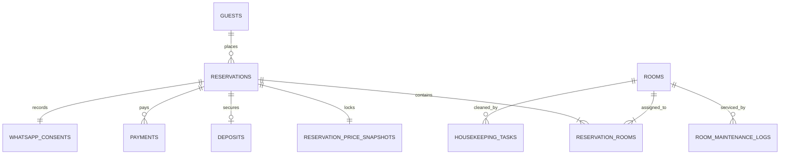

# DATABASE SCHEMA & BUSINESS RULES — ALYATAMA HOMESTAY

Dokumen ini mendokumentasikan skema database PostgreSQL Supabase serta aturan bisnis operasional perhotelan yang berlaku pada sistem ALYATAMA HOMESTAY.

---

## 1. Skema Relasional Tabel Utama

### 1.1 Tabel `rooms`
Menyimpan unit fisik kamar homestay beserta konfigurasi tarif multi-masa sewa:
- `id` (UUID / text, Primary Key)
- `room_number` (varchar 20, Unique)
- `name` (varchar 100) — e.g. "Kamar Shafa 01"
- `room_type` (varchar 50) — e.g. "Standard Queen"
- `description` (text)
- `capacity_adults` (int)
- `capacity_children` (int)
- `base_rate` (numeric) — Tarif sewa harian per malam (IDR)
- `monthly_rate` (numeric, nullable) — Tarif sewa bulanan 30 hari (IDR)
- `yearly_rate` (numeric, nullable) — Tarif sewa tahunan 365 hari (IDR)
- `operational_status` (enum: `tersedia`, `ditempati`, `menunggu_dibersihkan`, `sedang_dibersihkan`, `siap_digunakan`, `dalam_perawatan`, `tidak_dijual_sementara`)
- `amenities` (text[])
- `photos` (text[])
- `internal_notes` (text)
- `is_archived` (boolean)

### 1.2 Tabel `reservations`
Menyimpan permohonan dan catatan pemesanan tamu:
- `id` (UUID / text, Primary Key)
- `reservation_number` (varchar 50, Unique) — Format: `ALY-YYYYMMDD-XXXX`
- `guest_id` (UUID / text, Foreign Key ke `guests.id`)
- `checkin_date` (date)
- `checkout_date` (date)
- `adults` (int)
- `children` (int)
- `rental_type` (enum: `daily`, `monthly`, `yearly`)
- `duration_units` (int)
- `status` (enum: `pending_approval`, `approved_pending_payment`, `confirmed`, `checked_in`, `checked_out`, `cancelled`, `rejected`)
- `payment_status` (enum: `unpaid`, `partially_paid`, `paid`, `refunded`)
- `special_requests` (text)
- `internal_admin_notes` (text)

### 1.3 Tabel `reservation_price_snapshots`
Mengunci harga secara permanen saat pesanan disetujui (immutable audit trail):
- `id` (UUID, Primary Key)
- `reservation_id` (UUID, Unique)
- `rental_type` (varchar 20)
- `duration_units` (int)
- `unit_rate` (numeric)
- `total_nights` (int)
- `base_subtotal` (numeric)
- `nightly_breakdown` (jsonb)
- `discount_amount` (numeric)
- `discount_reason` (text)
- `promo_code` (text)
- `promo_snapshot` (jsonb)
- `extra_charges` (numeric)
- `deposit_required` (numeric) — Default 50%
- `total_amount` (numeric)
- `total_paid` (numeric)
- `balance_due` (numeric)

### 1.4 Tabel `whatsapp_consents`
Audit trail pemenuhan privasi komunikasi:
- `id` (UUID, Primary Key)
- `reservation_id` (UUID, Unique)
- `phone` (varchar 30)
- `has_consented` (boolean)
- `consent_timestamp` (timestamptz)

---

## 2. Aturan Bisnis Perhotelan (Business Rules)

### 2.1 Alur Persetujuan Anti Double Booking
1. Tamu mengajukan reservasi di web $\rightarrow$ status `pending_approval`.
2. Admin membuka dashboard PMS untuk mereview tanggal, identitas, dan kapasitas.
3. Saat tombol **Setujui** diklik:
   - Sistem melakukan query exclusion lock pada rentang `[checkin_date, checkout_date)` terhadap reservasi aktif lain di kamar yang sama.
   - Jika tersedia, status diubah menjadi `approved_pending_payment` (atau langsung `confirmed` bila disetujui tanpa DP).
   - Snapshot harga dikunci secara permanen.

### 2.2 Aturan Pembatalan & Pengembalian Deposit
- **H-3 atau lebih sebelum check-in:** Pembatalan bebas denda. Deposit dikembalikan penuh.
- **H-2 hingga Hari H:** Denda 50% dari nilai deposit yang telah dibayarkan.
- **No-Show (Tamu Tidak Hadir tanpa kabar hingga 22:00 WIB):** Deposit hangus untuk menutup alokasi kamar yang tidak dapat dijual ke pihak lain.

### 2.3 Kepatuhan Syariah ALYATAMA
- Tamu pasangan berlainan jenis wajib merupakan suami-istri sah atau keluarga mahram.
- Pengelola berhak meminta verifikasi KTP beralamat sama atau Buku Nikah saat check-in.
- Area homestay steril dari minuman beralkohol, narkotika, dan kegiatan maksiat.
- Donasi amal jariyah dialokasikan untuk santri Panti Asuhan Putra Muhammadiyah Bangkinang.
